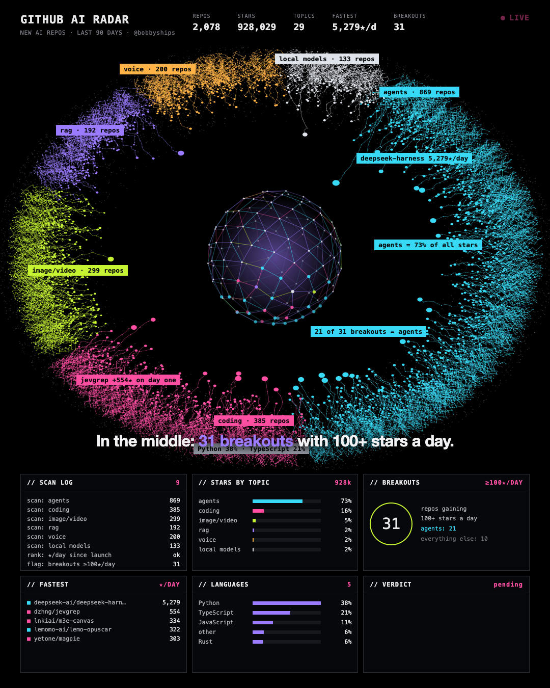
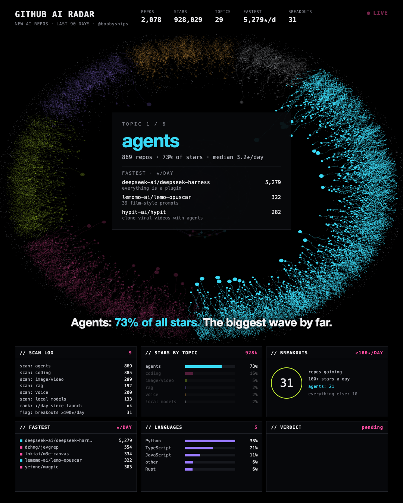
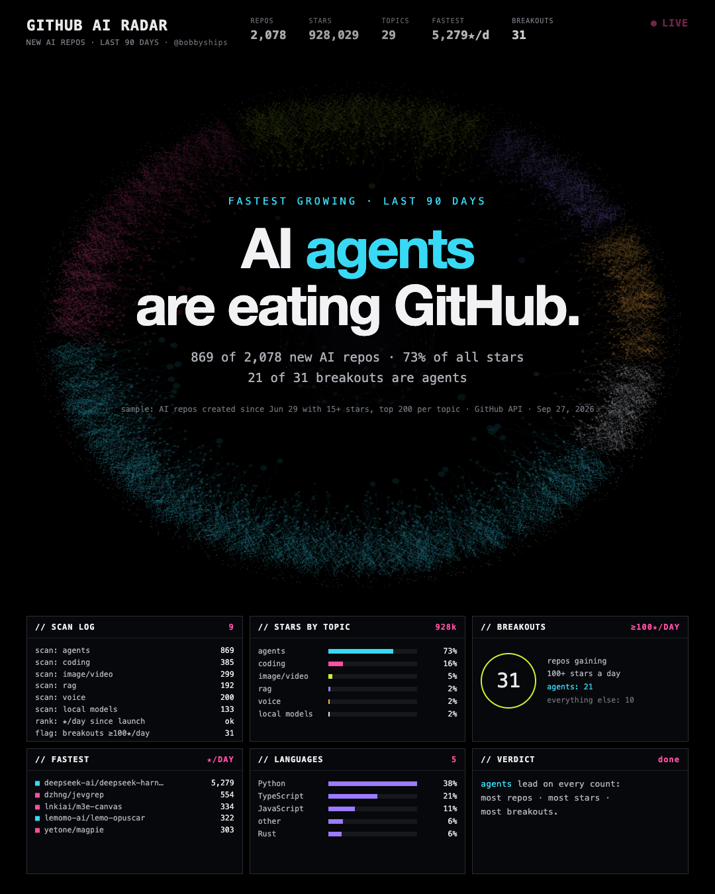

# GitHub AI Radar

An animated radar of **2,078 new AI repos on GitHub** (created in the last 90 days), rendered to a 2-minute video. No After Effects: every frame is HTML, canvas and JavaScript.



**The finding:** AI agents are eating GitHub. In this sample they make up 869 of 2,078 repos, 73% of all stars and 21 of the 31 breakouts (repos gaining 100+ stars a day).

## How to read it

- **Every dot is a repo.** The color shows the topic: agents, coding, image/video, RAG, voice, local models.
- **Closer to the center = growing faster** (stars per day since launch).
- **The sphere in the middle** holds the breakouts with 100+ stars a day.
- The video then tours all six topics and shows the three fastest repos of each.

| Topic tour | Verdict |
|---|---|
|  |  |

## Build your own with Claude Code

Open [Claude Code](https://claude.com/claude-code) in an empty folder and paste this prompt. Replace the part in brackets.

```text
Use https://github.com/plutunieer/github-ai-radar as the reference.
Clone it and build me the same kind of animated radar video, but for [YOUR TOPIC,
e.g. "new web3 repos" or "Python data tools"].

- Pull real data from the GitHub API with fetch_data.py (change the CATS topics).
- Keep the look: dark radar ring, breakout sphere, tags, six panels, topic tour, verdict.
- Update every hard-coded text in radar.html (tags, insights, descriptions, verdict)
  so it matches the new data. No invented numbers.
- Render stills first so I can check them, then the full MP4 with render.js.
```

## Run it yourself

Needs Python 3, the [GitHub CLI](https://cli.github.com/) (logged in), Node.js, Chrome and ffmpeg. Made on macOS; on Linux or Windows open `radar.html` in your browser and set `CHROME_PATH` for rendering, e.g. `CHROME_PATH=/usr/bin/google-chrome node render.js`.

```sh
python3 fetch_data.py          # fetch repos -> data.json + data.js (a few minutes)
open radar.html                # live preview in the browser
npm install
node render.js 25 33 108       # still images at these seconds
node render.js                 # full video -> radar.mp4 (silent)
```

Counters, bars, panels and the topic cards read from `data.js`. These hand-written texts in `radar.html` describe the snapshot in `data.json` and must be updated after a new fetch: `TAGS` (labels on the ring), `DESC` (one-line repo descriptions), `INSIGHT` and `CAPS` (subtitles), the scan-log line `['verdict', 'agents']`, the `VERDICT` panel text and the final verdict screen.

## About the data

A sample, not all of GitHub: repos with one of 29 AI topic tags, created after 29 June 2026, with more than 15 stars, and the top 200 per topic by stars. Fetched from the GitHub API on 27 September 2026. Repos without a matching topic tag are not included. A repo that matches several topics counts only for the first category in the list, and agents come first, so agents are slightly favoured.

The music in the posted video (Pixabay) is not part of this repo.

## License

MIT
